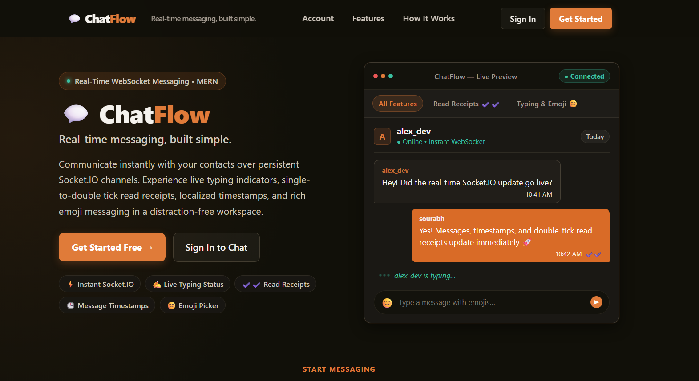

# ChatFlow — Real-Time Chat Application

A full-stack MERN real-time messaging application that enables users to register, sign in, and communicate instantly using WebSockets. Built with React, Node.js, Express, MongoDB, and Socket.IO.

---

## Live Demo

[ChatFlow Live](https://chat-flow-swart.vercel.app/)

---

## Reference Preview



---

## Quick Start

### 1. Clone the repository

```bash
git clone https://github.com/Sourabhpande532/CHAT_FLOW.git
cd CHAT_FLOW
```

### 2. Start the Backend Server

```bash
cd server
npm install
npm start
```

### 3. Start the Frontend Client

```bash
cd client
npm install
npm start
```

---

## Tech Stack

- **Frontend:** React, Tailwind CSS, Bootstrap 5, CSS3, Socket.IO Client, Axios, Emoji Picker React, React Hot Toast
- **Backend:** Node.js, Express.js, Socket.IO
- **Database:** MongoDB & Mongoose
- **Authentication:** JSON Web Tokens (JWT) & bcrypt

---

## Features

- **Authentication & Session Persistence:**
  - User registration and login with client-side and server-side validation
  - Password hashing using `bcrypt` and token generation with `jsonwebtoken`
  - Persistent user sessions across browser reloads via `localStorage`
- **Real-Time Messaging:**
  - Instant bidirectional message delivery using Socket.IO
  - Durable message persistence in MongoDB with compound indexing
- **Contact Discovery & Search:**
  - View all registered contacts (excluding the active user)
  - Instant contact search filter, unread message counters, and last-message previews
- **Live Typing Indicator:**
  - Real-time debounced `"User is typing…"` status indicator scoped to the active conversation
- **Read Receipts & Timestamps:**
  - Single check (`✔`) for sent messages and double check (`✔✔`) when read in real time
  - Formatted message timestamps and date group separators (`Today`, `Yesterday`, date)
- **Emoji Picker:**
  - Integrated emoji selector with search and keyboard/outside-click dismissal
- **Responsive Design:**
  - Tailored layout across desktop, tablet, and mobile viewports (`320px` to `1536px+`)

---

## API Reference

### `POST /auth/register`

Register a new user account.

**Sample Response (`201 Created`):**

```json
{
  "success": true,
  "message": "Registered successfully",
  "token": "jwt_token",
  "username": "user_name"
}
```

### `POST /auth/login`

Authenticate an existing user.

**Sample Response (`200 OK`):**

```json
{
  "success": true,
  "message": "Login successful",
  "username": "user_name"
}
```

### `GET /messages`

Fetch chronological conversation history between two users.

**Query Parameters:**
- `sender`
- `receiver`

**Sample Response (`200 OK`):**

```json
[
  {
    "_id": "message_id",
    "sender": "user1",
    "receiver": "user2",
    "message": "Hello!",
    "read": true,
    "createdAt": "2026-11-06T12:00:00.000Z"
  }
]
```

### `GET /users`

Fetch all registered users except the current logged-in user.

**Query Parameters:**
- `currentUser`

**Sample Response (`200 OK`):**

```json
[
  {
    "_id": "user_id",
    "username": "user_name",
    "createdAt": "2026-11-06T10:00:00.000Z"
  }
]
```

---

## Environment Variables

### Backend (`server/.env`)

```env
PORT=5000
MONGO_URI=mongodb+srv://<username>:<password>@cluster.mongodb.net/chatapp
JWT_SECRET=your_secret_key
CLIENT_URL=http://localhost:3000
```

### Frontend (`client/.env`)

```env
REACT_APP_API_BASE_URL=http://localhost:5000
```

---

## Contact

For questions, bug reports, or feature requests, reach out at [sourabhpande43@gmail.com](mailto:sourabhpande43@gmail.com).
